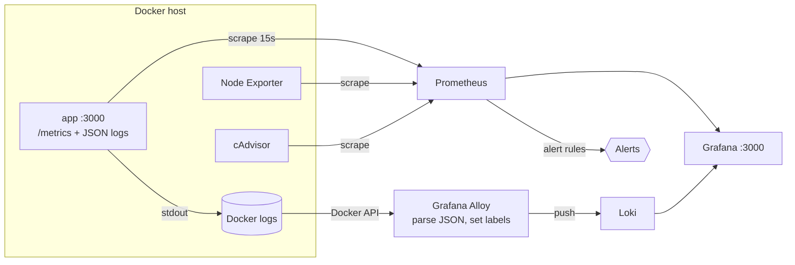
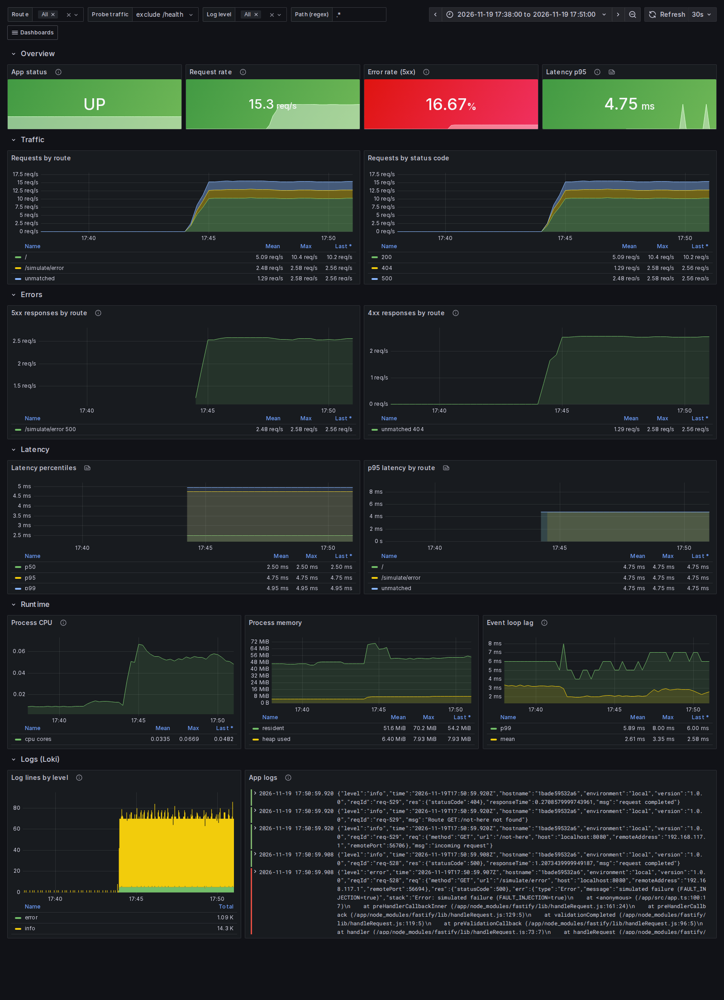
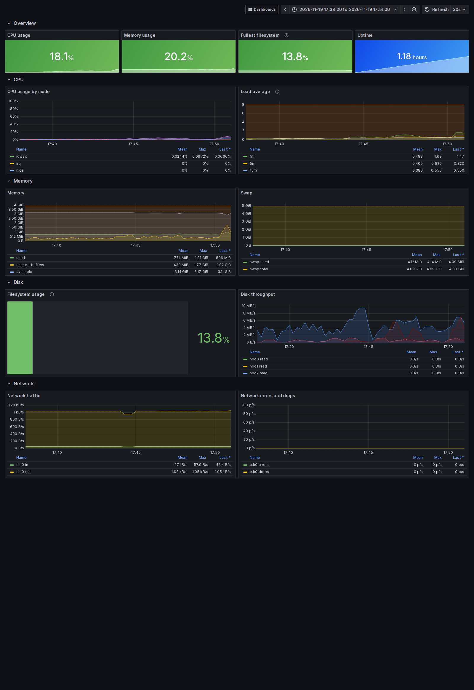
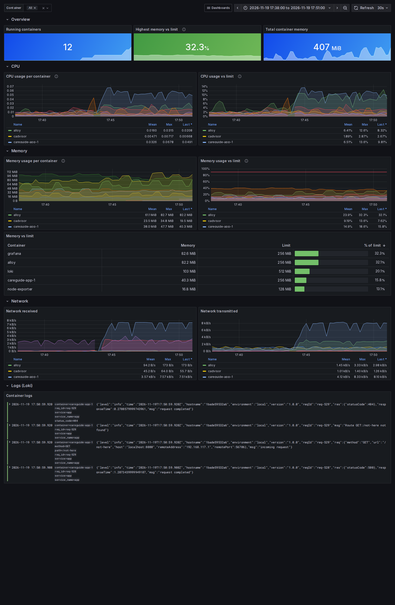
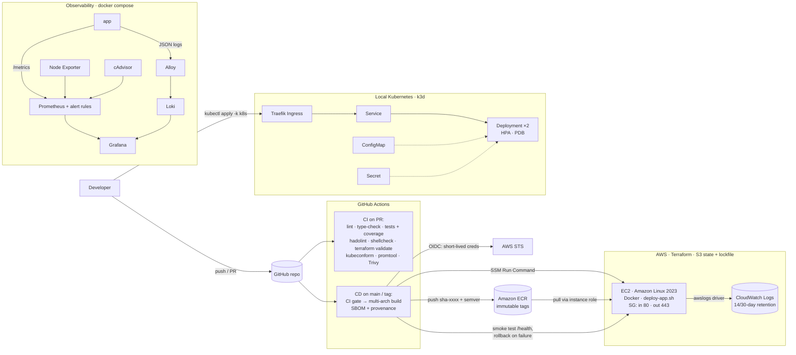

<div align="center">

# Task for Careguide

**Build, ship, deploy and monitor a small web service**

A Bun/Fastify service taken from source code to a production-ready, observable and securely deployed state.

[](https://github.com/monwarqx1250/devops-task/actions/workflows/cd.yml)


[Running locally](#running-locally) ·
[Architecture](#architecture) ·
[Observability](#observability-stack) ·
[CI/CD](#cicd-pipeline) ·
[Terraform](#infrastructure-as-code-terraform) ·
[Kubernetes](#kubernetes) ·
[Design decisions](#design-decisions)

</div>

<br/>

| Area | What is in this repository |
|---|---|
| Application | Fastify service with `/`, `/health`, `/metrics`, JSON logs, graceful shutdown, unit tests |
| Container | Multi-stage Dockerfile (Alpine, digest-pinned, non-root, health check, OCI labels), `docker-compose.yml` |
| CI/CD | GitHub Actions: lint, type-check, tests + coverage, hadolint, shellcheck, Trivy; multi-arch build to ECR via OIDC; SSM deploy with smoke test and automatic rollback |
| Infrastructure | Terraform for EC2 + IAM + ECR + CloudWatch Logs + GitHub OIDC, S3 remote state with locking, staging/production variables |
| Kubernetes | Kustomize manifests for k3d: Deployment, Service, Ingress, ConfigMap, Secret, HPA, PDB, restricted security context |
| Observability | Prometheus, Grafana, Loki, Grafana Alloy, Node Exporter, cAdvisor; dashboards and data sources as code; 6 alert rules with unit tests |
| Automation | `system_health.sh` with thresholds, JSON output, exit codes, log rotation, systemd timer and cron entry |

## Contents

- [Repository layout](#repository-layout)
- [Running locally](#running-locally)
- [Application](#application)
- [Container image](#container-image)
- [Observability stack](#observability-stack)
- [CI/CD pipeline](#cicd-pipeline)
- [Infrastructure as Code (Terraform)](#infrastructure-as-code-terraform)
- [Kubernetes](#kubernetes)
- [Linux automation: system_health.sh](#linux-automation-system_healthsh)
- [Architecture](#architecture)
- [Design decisions](#design-decisions)
- [Deployment and rollback strategy](#deployment-and-rollback-strategy)
- [Security considerations](#security-considerations)
- [AWS cost estimate](#aws-cost-estimate)
- [What I would improve with more time](#what-i-would-improve-with-more-time)
- [Use of AI tools](#use-of-ai-tools)

---

## Repository layout

```
.
├── server.ts, src/            # Fastify app (config, routes, metrics)
├── test/                      # Bun unit tests
├── Dockerfile, .dockerignore
├── docker-compose.yml         # app; includes the monitoring stack
├── .env.example               # template for .env (Grafana admin credentials)
├── k6.js                      # load / error-spike generator
├── monitoring/
│   ├── docker-compose.yaml    # Prometheus, Grafana, Loki, Alloy, Node Exporter, cAdvisor
│   ├── prometheus/            # scrape config, alert rules, rule unit tests
│   ├── loki.yml
│   ├── alloy/config.alloy     # Docker log discovery + JSON parsing
│   └── grafana/               # provisioned data sources and dashboards (JSON)
├── .github/workflows/         # ci.yml (pull requests), cd.yml (main / tags)
├── terraform/                 # EC2 deployment target; bootstrap/ creates the state bucket
├── k8s/                       # Kustomize manifests, k3d cluster config, rollout demo
├── scripts/
│   ├── system_health.sh       # host health check
│   ├── deploy-app.sh          # deploy/rollback on EC2 (installed by user data)
│   ├── ci/ssm-run.sh          # run a command over SSM from CI
│   ├── systemd/               # service + timer (every 5 minutes)
│   └── cron/                  # cron alternative
└── docs/screenshots/          # dashboard screenshots
```

---

## Running locally

**Requirements:** Docker Engine 24+ with Docker Compose v2.20+ (needed for `include:`). [Bun](https://bun.sh) 1.3.8+ and [k6](https://k6.io) are only needed for the tests and load generation.

The whole system (app plus observability stack) is a single Compose project. Grafana's admin credentials are read from a git-ignored `.env` file whose format is documented in `.env.example`. Compose refuses to start if `GRAFANA_ADMIN_PASSWORD` is missing.

```bash
cp .env.example .env            # Grafana credentials (edit the password)
docker compose up -d --build    # app + observability stack
docker compose ps               # all services healthy / running
```

| What | URL | Notes |
|---|---|---|
| App | http://localhost:8080 | `/`, `/health`, `/metrics` |
| Grafana | http://localhost:3000 | user/password from `.env`; dashboards are in the **DevOps Task** folder; the Application dashboard is the home page |
| Prometheus, Loki, Alloy, Node Exporter, cAdvisor | not published | internal Docker network only; open them through Grafana (Explore) |

**Load and error traffic.** `k6.js` produces steady traffic against the app. When the app runs with `FAULT_INJECTION=true`, `ERROR_RATIO` sends that share of requests to `/simulate/error`. A ratio of 0.2 held for more than 5 minutes fires `AppHighErrorRate`. This is how the dashboard screenshots below were produced.

```bash
k6 run k6.js                                         # normal traffic
FAULT_INJECTION=true docker compose up -d app        # app with the demo-only error route
k6 run -e ERROR_RATIO=0.2 -e DURATION=8m k6.js       # ~20% 5xx
```

`docker compose down` stops the stack; with `-v` it also removes the Prometheus, Loki, Grafana and Alloy volumes.

> **Known limitation: Docker's containerd image store.** cAdvisor reads container metadata from Docker's classic `overlay2` storage layout. Engines that use the containerd image store (`docker info` shows `driver-type=io.containerd.snapshotter.v1`, the default on some recent Docker Desktop and OrbStack installs) leave cAdvisor without per-container metrics. The classic store (`"features": {"containerd-snapshotter": false}` in the daemon config) and standard Linux hosts such as the EC2 instance are not affected.

---

## Application

A [Fastify](https://fastify.dev) service running on Bun.

| Endpoint | Response |
|---|---|
| `GET /` | `{"message": "Hello from DevOps Task!", "status": "running", "version": "<APP_VERSION>"}` |
| `GET /health` | `{"status": "ok"}`, used by Docker, Kubernetes and the deploy smoke test |
| `GET /metrics` | Prometheus text format |
| `GET /simulate/error` | 500, **only registered when `FAULT_INJECTION=true`** (demo of an error spike) |

**Metrics.** `http_requests_total{method,route,status_code}`, `http_request_errors_total{method,route,status_code}` (5xx only), `http_request_duration_seconds{method,route,status_code}` histogram, plus default process metrics (CPU, resident memory, heap, event-loop lag, GC). `route` is the route **template** and unknown paths are reported as `route="unmatched"`, so a scanner hitting random URLs cannot create unbounded label values. `/metrics` itself is not counted.

**Configuration** (environment variables only):

| Variable | Default | Purpose |
|---|---|---|
| `PORT` | `3000` | listen port |
| `LOG_LEVEL` | `info` | pino level (`trace`…`fatal`, `silent`) |
| `ENVIRONMENT` | `development` | environment name, added to every log line |
| `APP_VERSION` | `1.0.0` | version returned by `/` and logged; the image sets it from the build |
| `FAULT_INJECTION` | `false` | enables `/simulate/error` |

**Logs** are structured JSON on stdout with string levels and ISO timestamps, e.g.
`{"level":"info","time":"2026-11-19T17:16:10.023Z","hostname":"…","environment":"local","version":"1.0.0","reqId":"req-1","req":{"method":"GET","url":"/"},"msg":"incoming request"}`.

**Graceful shutdown.** On `SIGTERM`/`SIGINT` the server stops accepting connections (new requests get 503), finishes in-flight requests and exits 0.

**Tests and static checks** (the same commands run in CI):

```bash
bun install
bun test                 # 7 tests: endpoints, metrics labels, 5xx counting, fault-injection gating
bun run test:coverage    # text + lcov coverage
bun run lint             # Biome
bun run typecheck        # tsc --noEmit
```

---

## Container image

- **Multi-stage**: a `dependencies` stage installs production dependencies from `bun.lock` (`--frozen-lockfile`); the `runtime` stage copies only `node_modules`, `server.ts`, `src/` and `package.json`.
- **Base image** `oven/bun:1.3.8-alpine`, pinned by **version and multi-arch digest**.
- **Final image size: ~118 MB** (`docker image ls`, uncompressed). Almost all of it is the Bun runtime; the app and its dependencies are a few MB.
- **Non-root**: runs as `bun` (uid 1000). Compose, the EC2 deploy script and Kubernetes add a read-only root filesystem with a tmpfs `/tmp`.
- `HEALTHCHECK` on `/health`, `STOPSIGNAL SIGTERM`, OCI labels (`title`, `version`, `revision`, `created`, `source`, `licenses`, `base.name`) filled in from build args by CI.
- `.dockerignore` is an allow-list: only the four paths above are sent to the build context.
- hadolint reports no warnings.

`docker-compose.yml` runs the app on **port 8080** with a health check, `restart: unless-stopped`, CPU/memory limits and reservations, `init: true` (signal forwarding and zombie reaping) and `read_only: true`.

---

## Observability stack

All six components are defined in `monitoring/docker-compose.yaml`, which the root compose file pulls in with `include:`, so one `docker compose up` starts everything. Every image is pinned and every service has CPU/memory limits.

| Component | Image | Role |
|---|---|---|
| Prometheus | `prom/prometheus:v3.4.1` | scrapes app, Node Exporter, cAdvisor every 15s; evaluates alert rules; **retention 15 days or 2 GB**, whichever comes first |
| Loki | `grafana/loki:3.5.0` | log storage, **retention 7 days** (`limits_config.retention_period: 168h`, compactor deletes expired data), persistent volume |
| Grafana Alloy | `grafana/alloy:v1.9.1` | discovers containers through the Docker API, tails their logs, parses the app's JSON, pushes to Loki |
| Node Exporter | `prom/node-exporter:v1.9.1` | host CPU, memory, disk, network |
| cAdvisor | `gcr.io/cadvisor/cadvisor:v0.52.1` | per-container CPU, memory, limits, network |
| Grafana | `grafana/grafana:12.0.2` | dashboards; **the only service published to the host** |

### Metrics and logs flow



### Log labels and cardinality

Alloy (`monitoring/alloy/config.alloy`) attaches four **index labels** to every stream:

| Label | Values | Why it is a label |
|---|---|---|
| `container` | one per container | select a container's logs |
| `service` | compose service name (`app`, `loki`, …) | stable across container re-creation |
| `project` | compose project | separates stacks on a shared host |
| `level` | `trace`…`fatal` (at most 6) | the most common filter (`level="error"`), tiny value set |

For the app's JSON logs it also extracts `path`, `method`, `status_code` and `req_id`, but stores them as **Loki structured metadata**, not labels. Each label value combination creates a separate stream in Loki's index. `req_id` is unique per request and `path` is unbounded (any URL a client sends), so making them labels would create a stream per request and degrade Loki. Structured metadata can still be filtered in Grafana (`{service="app"} | path="/simulate/error"`) without growing the index.

### Host access for cAdvisor and Node Exporter

Both need to see the host rather than their own container. Every host mount is **read-only**, and neither container is privileged.

| Container | Mount / setting | Why |
|---|---|---|
| Node Exporter | `/proc:/host/proc:ro` | host CPU, memory, load, network counters (`--path.procfs`) |
| Node Exporter | `/sys:/host/sys:ro` | hardware and network-interface details (`--path.sysfs`) |
| Node Exporter | `/:/rootfs:ro` | filesystem usage of the host's mounts (`--path.rootfs`); pseudo filesystems and Docker overlay mounts are excluded |
| cAdvisor | `/sys:/sys:ro` | cgroup statistics: the actual CPU/memory numbers per container |
| cAdvisor | `/var/lib/docker:/var/lib/docker:ro` | container metadata and layer information |
| cAdvisor | `/var/run:/var/run:ro` | Docker socket, to map cgroups to container names and labels |
| cAdvisor | `/:/rootfs:ro` | host filesystem information |
| Alloy | `/var/run/docker.sock:ro` | container discovery and log tailing |

`:ro` on the Docker socket only stops writes to the socket file. Anything that can talk to the Docker API is effectively root on the host. That is the accepted cost of Docker service discovery and is why Alloy and cAdvisor are trusted, pinned images with no published ports. On Kubernetes, the same data comes from the kubelet and a DaemonSet log agent instead.

cAdvisor is also run with `--docker_only`, rarely used metric groups disabled (`percpu,sched,tcp,udp,disk,diskIO,hugetlb,…`) and only the compose service/project labels exported, to keep cardinality low.

### Dashboards (provisioned as code)

Data sources (`monitoring/grafana/provisioning/datasources/`) and dashboards (`monitoring/grafana/dashboards/*.json`) are loaded from the repository at startup. UI edits are not saved (`allowUiUpdates: false`), so the JSON files stay the source of truth.

**Application**: request rate, error rate (5xx %), p50/p95/p99 latency, traffic by route and status, 4xx vs 5xx, runtime (CPU, memory, event-loop lag), and **Loki logs next to the metrics** (log volume by level, filterable log panel). `/health` probe traffic is excluded by default (a dashboard variable switches it back on).



**Host**: CPU (total and by mode), load vs core count, memory, swap, usage per filesystem (80% line), disk throughput, network traffic and errors.



**Containers**: per-container CPU and memory, **usage relative to the configured CPU and memory limits**, a memory vs limit table, network, and logs of the selected container.



### Alerting

Rules are in `monitoring/prometheus/alerts.yml`, with unit tests in `monitoring/prometheus/tests/alerts_test.yml`. CI runs `promtool check rules` and `promtool test rules`, and `AppHighErrorRate` was verified to fire against a real error spike from `/simulate/error`.

| Alert | Condition | `for` | Severity | Reasoning |
|---|---|---|---|---|
| `AppInstanceDown` | `up{job="app"} == 0` | 1m | critical | 4 consecutive failed scrapes at 15s. A normal restart (~5s) does not fire; a crash loop or a hung process does. |
| `AppHighErrorRate` | 5xx share > **5%** over 5m **and** > 0.1 req/s | 5m | critical | 5% is well above normal noise (the service has no expected 5xx) but low enough to catch partial outages. The traffic guard stops one failed request on an idle service from paging anyone. 5m of sustained errors rules out a single bad burst. |
| `AppHighLatency` | p95 > **500 ms** (excluding `/health`) | 10m | warning | Normal p95 is ~5 ms; 500 ms is user-visible slowness. Latency is noisier than errors, hence the longer window and warning severity. |
| `HostDiskUsageHigh` | any real filesystem > **80%** | 10m | warning | Leaves time to act before a full disk breaks Docker, Prometheus and Loki. Disks fill slowly; 10m ignores transient spikes (image pulls, log bursts). |
| `ContainerMemoryNearLimit` | working set > **90%** of the memory limit | 5m | warning | The kernel OOM-kills at 100%, so 90% sustained for 5m is the last useful warning. Containers without a limit are excluded. |
| `ScrapeTargetDown` | any other target `up == 0` | 2m | warning | If Node Exporter or cAdvisor stops, dashboards and the host/container alerts silently go blind. |

Thresholds are drawn on the matching panels (red at 5% errors, 80% disk, 90% memory vs limit), so the dashboards and the alerts agree. Firing alerts are visible in Grafana (Alerting → Alert rules, data source Prometheus) and in Prometheus. Routing to Slack/Discord through Alertmanager is listed under improvements.

### Walkthrough: "An error spike appears on the Application dashboard. How do you find the cause?"

1. **Confirm and size it (Application → Overview).** *Error rate (5xx)* turns orange, then red. *Request rate* in the same row separates the two common cases: errors at normal traffic point to the app, errors during a traffic surge point to load. `AppHighErrorRate` fires once the rate stays above 5% for 5 minutes.
2. **Which endpoint? (Errors row).** *5xx responses by route* shows which route template is failing and with which status (500, 502, 503…). In the screenshot above it is `/simulate/error` returning 500. The *4xx* panel is separate, so a scanner's 404s don't hide the real failure.
3. **Is it slow as well as failing? (Latency row).** A p99 jump on the same route suggests timeouts or a slow dependency; failing fast with flat latency suggests a code or config error.
4. **Read the errors (Logs row, same dashboard).** *Log lines by level* shows `error` lines rising at the same moment. With **Log level = error** and **Path** set to the failing route, the log panel lists the error messages and stack traces (here `simulated failure (FAULT_INJECTION=true)`). Each line carries `req_id`, `method`, `path` and `status_code`. Filtering on a `req_id` in Explore (`{service="app"} | req_id="req-1a"`) shows the whole request.
5. **Rule out resources (Containers and Host dashboards).** Memory near the container limit points to OOM kills, which show up as 502s and restarts. CPU pinned at the limit means throttling. Host disk or memory exhaustion affects every container. `AppInstanceDown` and a dropping *Running containers* count indicate crashes.
6. **Correlate with a change.** Every log line carries the deployed `version`. A spike that starts with a new version points to the release, and the [rollback](#deployment-and-rollback-strategy) restores the previous tag.

The screenshot above was taken during a spike produced by the fault-injection route and `k6.js` with `ERROR_RATIO=0.2`.

---

## CI/CD pipeline

### Pull requests: `.github/workflows/ci.yml`

| Job | Checks |
|---|---|
| `app` | `bun install --frozen-lockfile`, Biome lint, `tsc --noEmit`, unit tests with coverage (summary in the run, lcov as an artifact) |
| `lint-infra` | hadolint (fails on warnings), shellcheck on every script, actionlint on the workflows |
| `terraform` | `terraform fmt -check`, `init -backend=false`, `validate` (stack and bootstrap) |
| `kubernetes` | renders the Kustomize manifests and validates them with kubeconform (strict, Kubernetes 1.31 schemas) |
| `monitoring` | `promtool check rules`, `promtool test rules`, `docker compose config` |
| `image` | builds the image (GitHub Actions layer cache), records its size, **Trivy image scan that fails on CRITICAL** (with a fix available), a HIGH report for information, and a Trivy misconfiguration scan of the Dockerfile, Terraform and Kubernetes manifests (fails on HIGH/CRITICAL) |

### Push to `main` or a release tag: `.github/workflows/cd.yml`

1. **CI gate**: the whole CI workflow runs again (`workflow_call`).
2. **Resolve environment and version**: `main` → `staging`, version `<package.json version>-main.<run number>` (a SemVer pre-release); tag `vX.Y.Z` → `production`, version `X.Y.Z` (the tag must match `package.json`).
3. **Build and push**: multi-arch (`linux/amd64`, `linux/arm64`) with Buildx and QEMU, **GitHub Actions layer cache**, SBOM and provenance attestations. Pushed to **Amazon ECR** using **GitHub OIDC** (no AWS keys stored in GitHub). Tags: `sha-<7 chars>` and the SemVer version; `latest` is never used and the ECR repository has **immutable tags**.
4. **Deploy** over **SSM Run Command** (no SSH, no open port 22):
   - record the currently deployed tag;
   - run `deploy-app.sh sha-xxxxxxx` on the instance: pull, replace the container, health-check `/health` for up to 60s, and **restore the previous tag automatically** if the new one never becomes healthy;
   - **external smoke test**: `/health` and `/` (checks the returned version) through the instance's public DNS name;
   - if the smoke test fails, the workflow **rolls back to the recorded previous tag** and fails.

Deploys to the same environment never run concurrently and are never cancelled midway.

### Required configuration

The pipeline uses no GitHub **secrets**: AWS access is through OIDC. It reads four **variables** from two GitHub Environments, `staging` and `production`, with `production` protected by required reviewers. Their values are Terraform outputs:

| Variable | Example | From |
|---|---|---|
| `AWS_ROLE_ARN` | `arn:aws:iam::123456789012:role/devops-task-staging-github-deploy` | `terraform output github_actions_role_arn` |
| `AWS_REGION` | `us-east-1` | your tfvars |
| `ECR_REPOSITORY` | `123456789012.dkr.ecr.us-east-1.amazonaws.com/devops-task-staging` | `terraform output ecr_repository_url` |
| `EC2_INSTANCE_ID` | `i-0abc…` | `terraform output instance_id` |

The OIDC role's trust policy only accepts tokens for `repo:<owner>/<repo>:environment:<env>`, so a workflow on another branch or a fork cannot assume it.

> **Evidence.** *TODO: add a screenshot or log of a successful CD run (build → deploy → smoke test) here, e.g. `docs/screenshots/cd-run.png`.*

---

## Infrastructure as Code (Terraform)

`terraform/` provisions one deployment target per environment:

| Resource | Details |
|---|---|
| EC2 instance | Amazon Linux 2023 (latest AMI via SSM parameter), default VPC, `t3.micro` (staging, Free Tier) / `t3.small` (production), IMDSv2 required with hop limit 1 (containers can't reach instance credentials), encrypted gp3 root volume |
| Security group | **inbound TCP 80 only** (configurable CIDRs), **outbound TCP 443 only**; no SSH (shell access via SSM Session Manager) |
| IAM instance profile | ECR pull **for this repository only**, CloudWatch Logs write **to this log group only**, and `AmazonSSMManagedInstanceCore`. No static access keys anywhere. |
| User data | installs Docker, writes `/etc/devops-task/deploy.env`, installs `scripts/deploy-app.sh` as `/usr/local/bin/deploy-app.sh`, optionally starts an initial image tag |
| CloudWatch Logs | `/devops-task/<env>/app`, **retention 14 days (staging) / 30 days (production)**; Docker's `awslogs` driver ships container stdout/stderr |
| ECR | `devops-task-<env>`, immutable tags, scan on push, keeps the last 20 images |
| GitHub OIDC | identity provider (created once per account) and a deploy role limited to: push to this ECR repository, `ssm:SendCommand` on this instance with `AWS-RunShellScript`, read command results, describe instances |
| Remote state | S3 (versioned, encrypted, public access blocked, TLS-only) with **S3-native state locking** (`use_lockfile = true`, Terraform ≥ 1.10, no DynamoDB table needed); separate state key per environment |

### Usage

**State bucket.** The bucket is created once per account by `terraform/bootstrap`, which uses local state. Each environment then has:
- a backend config (`envs/<env>.backend.hcl`) naming that bucket and its own state key;
- a variables file (`envs/<env>.tfvars`).

Staging creates the account's GitHub OIDC provider (`create_github_oidc_provider = true`), and production reuses it. The `terraform output` values feed the GitHub environment variables listed under [Required configuration](#required-configuration).

```bash
# State bucket (once per account)
terraform -chdir=terraform/bootstrap init
terraform -chdir=terraform/bootstrap apply -var state_bucket_name=<globally-unique-bucket>

# Staging
terraform -chdir=terraform init -backend-config=envs/staging.backend.hcl
terraform -chdir=terraform plan  -var-file=envs/staging.tfvars -out=staging.tfplan
terraform -chdir=terraform apply staging.tfplan
terraform -chdir=terraform output

# Production (same code, separate state and variables)
terraform -chdir=terraform init -reconfigure -backend-config=envs/production.backend.hcl
terraform -chdir=terraform plan -var-file=envs/production.tfvars -out=production.tfplan
terraform -chdir=terraform apply production.tfplan

# Teardown
terraform -chdir=terraform destroy -var-file=envs/<env>.tfvars
```

Validation: `terraform fmt -check`, `terraform validate` and a Trivy misconfiguration scan pass. Two Trivy findings are accepted and documented inline with `trivy:ignore`: SSE-S3 instead of a customer-managed KMS key on the state bucket, and outbound 443 to `0.0.0.0/0`, which is needed to reach the public ECR/SSM/CloudWatch endpoints without paid VPC endpoints.

> **Evidence.** *TODO: add the `terraform plan` output and a screenshot/log of a successful `apply` here (resources were destroyed after testing).*

---

## Kubernetes

Manifests live in `k8s/` and are assembled with Kustomize (`kubectl apply -k k8s`).

| Object | Highlights |
|---|---|
| Namespace `devops-task` | enforces the **restricted** Pod Security Standard |
| Deployment | **2 replicas**, `RollingUpdate` with `maxSurge: 1`, `maxUnavailable: 0`, `minReadySeconds: 5`; startup, readiness and liveness probes on `/health`; requests `50m`/`64Mi`, limits `500m`/`256Mi`; `preStop` sleep so endpoints are removed before SIGTERM; spread across nodes |
| Security context | `runAsNonRoot` (uid 1000), `readOnlyRootFilesystem`, `allowPrivilegeEscalation: false`, all capabilities dropped, `RuntimeDefault` seccomp, writable `/tmp` emptyDir; the ServiceAccount has no API token |
| ConfigMap | generated from literals (`PORT`, `LOG_LEVEL`, `ENVIRONMENT`); the content hash in its name triggers a rollout on change |
| Secret | generated from **`k8s/secret.env`, which is git-ignored**; `k8s/secret.env.example` documents the keys. Nothing sensitive is committed. |
| Service + Ingress | ClusterIP Service; Traefik Ingress on `devops-task.localhost` |
| HorizontalPodAutoscaler | CPU at **70%** of requests, 2–6 replicas, scale-down stabilised over 120s |
| PodDisruptionBudget | `minAvailable: 1` during node drains |

### Local deployment

The manifests were tested on **OrbStack Kubernetes** (v1.36, single node) and work the same on k3d. The clusters differ in where images come from and which add-ons are built in:
- **OrbStack and Docker Desktop** use the local Docker image store, so a `docker build` is all that's needed.
- **k3d** has its own image store, populated with `k3d image import`.

The Secret is generated from `k8s/secret.env`, which is created from `k8s/secret.env.example`.

| Cluster | Ingress | HPA metrics |
|---|---|---|
| k3d (`k8s/k3d-cluster.yaml`) | Traefik built in; `http://devops-task.localhost:8081` | metrics-server built in |
| OrbStack / Docker Desktop | no controller by default: use `port-forward`, or install Traefik (or ingress-nginx and change `ingressClassName`) | install [metrics-server](https://github.com/kubernetes-sigs/metrics-server); local clusters usually need `--kubelet-insecure-tls`. Until then `kubectl get hpa` shows `<unknown>` |

**OrbStack / Docker Desktop:**

```bash
docker build --target runtime --build-arg VERSION=1.0.0 -t devops-task:1.0.0 .
cp k8s/secret.env.example k8s/secret.env                  # Secret values
kubectl --context orbstack apply -k k8s
kubectl --context orbstack -n devops-task rollout status deploy/app
kubectl --context orbstack -n devops-task port-forward svc/app 8082:80 &
curl http://localhost:8082/                                # {"message":"Hello from DevOps Task!",...}
```

**k3d:**

```bash
k3d cluster create --config k8s/k3d-cluster.yaml         # k3s with Traefik and metrics-server; Ingress on :8081
docker build --target runtime --build-arg VERSION=1.0.0 -t devops-task:1.0.0 .
k3d image import devops-task:1.0.0 -c devops-task
cp k8s/secret.env.example k8s/secret.env                  # Secret values
kubectl --context k3d-devops-task apply -k k8s
kubectl --context k3d-devops-task -n devops-task rollout status deploy/app
curl http://devops-task.localhost:8081/                    # through the Ingress
# Port-forward alternative:
kubectl --context k3d-devops-task -n devops-task port-forward svc/app 8082:80 &
curl http://localhost:8082/health
kubectl --context k3d-devops-task -n devops-task get hpa   # CPU target vs current usage
```

### Zero-downtime rolling update and rollback

`k8s/demo-rollout.sh` builds `1.0.0` and `1.1.0` (and imports them on k3d), then:
1. starts a probe pod that calls the Service every 50 ms from inside the cluster, the same endpoint switching an Ingress relies on, so no ingress controller is needed;
2. runs `kubectl set image` to `1.1.0`, then `kubectl rollout undo`;
3. reports the number of non-200 responses for each step.

```bash
kubectl --context orbstack apply -k k8s
k8s/demo-rollout.sh orbstack              # or: k8s/demo-rollout.sh k3d-devops-task
```

The rollout and rollback themselves are standard `kubectl` operations:

```bash
kubectl -n devops-task set image deployment/app app=devops-task:1.1.0
kubectl -n devops-task rollout status deployment/app
kubectl -n devops-task rollout history deployment/app
kubectl -n devops-task rollout undo deployment/app
```

**Output** (OrbStack Kubernetes v1.36; repeated `Waiting for deployment…` lines trimmed):

```text
==> Current state
deployment "app" successfully rolled out
NAME   READY   UP-TO-DATE   AVAILABLE   AGE   CONTAINERS   IMAGES              SELECTOR
app    2/2     2            2           46s   app          devops-task:1.0.0   app.kubernetes.io/name=devops-task

==> Start an in-cluster probe: GET http://app.devops-task.svc.cluster.local/ every 50 ms
requests during baseline: total=47 non-200=0
{"message":"Hello from DevOps Task!","status":"running","version":"1.0.0"}

==> Rolling update to 1.1.0
deployment.apps/app image updated
Waiting for deployment "app" rollout to finish: 1 out of 2 new replicas have been updated...
Waiting for deployment "app" rollout to finish: 1 old replicas are pending termination...
deployment "app" successfully rolled out
requests during rolling update: total=297 non-200=0
{"message":"Hello from DevOps Task!","status":"running","version":"1.1.0"}
REVISION  CHANGE-CAUSE
1         <none>
2         update to 1.1.0

==> Rollback with kubectl rollout undo
deployment.apps/app rolled back
Waiting for deployment "app" rollout to finish: 1 out of 2 new replicas have been updated...
Waiting for deployment "app" rollout to finish: 1 old replicas are pending termination...
deployment "app" successfully rolled out
requests during rollback: total=292 non-200=0
{"message":"Hello from DevOps Task!","status":"running","version":"1.0.0"}
```

**589 requests across the update and rollback, 0 failures.**

A broken release is also safe. Setting a non-existent image tag left the new pod in `ImagePullBackOff` while both old pods kept serving (`READY 2/2`, `UP-TO-DATE 1`, `AVAILABLE 2`), because `maxUnavailable: 0` never removes a ready pod before its replacement is ready. `kubectl rollout undo` then removed the bad pod.

Also verified in the running pods:
- uid 1000; root filesystem read-only, `/tmp` writable;
- `CapEff: 0` and `NoNewPrivs: 1`; no service-account token mounted;
- ConfigMap and Secret values present in the environment;
- the namespace's *restricted* Pod Security Standard admitted the pods with no warnings.

Zero downtime comes from `maxUnavailable: 0` (old pods stay until new ones are ready), readiness probes (traffic only reaches ready pods), `minReadySeconds` and the `preStop` delay (no requests sent to a pod that is shutting down), and the app's graceful shutdown.

### How this changes for production on EKS

| Concern | Local (k3d) | EKS |
|---|---|---|
| Ingress | Traefik | AWS Load Balancer Controller (`ingressClassName: alb`) with an ALB, ACM certificate for TLS, optionally AWS WAF |
| Secrets | Kustomize-generated Secret from a git-ignored file | AWS Secrets Manager or SSM Parameter Store synced by External Secrets Operator (or the Secrets Store CSI driver); KMS envelope encryption of Kubernetes secrets |
| IAM for pods | none needed | IAM Roles for Service Accounts (IRSA) or EKS Pod Identity, one role per workload, least privilege |
| Node scaling | fixed nodes | Karpenter (or Cluster Autoscaler) across multiple AZs, with the HPA scaling pods and Karpenter adding nodes |
| Images | `k3d image import` | ECR with immutable tags, scanned on push, pulled by digest |
| Delivery | `kubectl apply -k` | GitOps (Argo CD or Flux) from the repo, with Argo Rollouts for canary releases and automatic rollback on error-rate analysis |
| Observability | Docker-based stack | kube-prometheus-stack or Amazon Managed Prometheus/Grafana, Alloy/Fluent Bit DaemonSet to Loki or CloudWatch |
| Network | open in-cluster | NetworkPolicies (VPC CNI network policy support), private subnets for nodes, security groups for pods |
| Resilience | single cluster | topology spread across AZs, PDBs (already present), resource quotas and limit ranges per namespace |

---

## Linux automation: system_health.sh

`scripts/system_health.sh` collects CPU usage (sampled from `/proc/stat`), memory usage (`MemAvailable`), disk usage of **every real mounted filesystem** (pseudo filesystems skipped), load average and the **top 5 processes by memory**. It appends a timestamped entry to `health_log.txt`, prints `[WARNING]`/`[CRITICAL]` lines for exceeded thresholds, and exits with a monitoring-friendly code.

```bash
scripts/system_health.sh --help
scripts/system_health.sh                                  # human-readable report
scripts/system_health.sh --disk 80 --cpu 90 --mem 85      # warning thresholds
scripts/system_health.sh --json --log-file /var/log/system_health/health_log.txt
HEALTH_WEBHOOK_URL=https://hooks.slack.com/services/… scripts/system_health.sh -q   # alert to Slack/Discord
```

| Option | Default | Meaning |
|---|---|---|
| `--cpu` / `--cpu-crit` | 90 / 95 | CPU % warning / critical |
| `--mem` / `--mem-crit` | 85 / 95 | memory % warning / critical |
| `--disk` / `--disk-crit` | 80 / 90 | disk % warning / critical (per filesystem) |
| `--json` | off | JSON to stdout, one JSON line per entry in the log |
| `--log-file` | `health_log.txt` | log file |
| `--max-size` / `--keep` | 1 MiB / 5 | rotate when the log exceeds the size; keep N old files (`.1` … `.N`) |
| `-q`, `--quiet` | off | print only warnings (for cron/systemd) |

**Exit codes:** `0` healthy, `1` warning, `2` critical, `3` usage or runtime error. Every option also has an environment default (`HEALTH_DISK_WARN`, `HEALTH_LOG_FILE`, …). Uses `set -euo pipefail`, validates all input, and passes shellcheck with no warnings.

**Scheduling.** A systemd service and timer in `scripts/systemd/` run the script every 5 minutes. systemd is preferred over cron because it adds journal logging, sandboxing, and `Persistent=true` catch-up after downtime. Installation on a host:

```bash
sudo install -m 0755 scripts/system_health.sh /usr/local/bin/system_health.sh
sudo install -m 0644 scripts/systemd/system-health.{service,timer} /etc/systemd/system/
sudo systemctl daemon-reload && sudo systemctl enable --now system-health.timer
systemctl list-timers system-health.timer
```

The cron alternative, `scripts/cron/system-health`, belongs in `/etc/cron.d/`.

---

## Architecture



---

## Design decisions

**Bun + Fastify.** Fastify gives route templates (for low-cardinality metric labels), structured logging (pino) and graceful close built in. Bun runs TypeScript directly, so there's no build step, and has a fast built-in test runner.

**Alpine instead of distroless.** `oven/bun` has an Alpine variant pinned by digest; a distroless Bun image has no shell or `wget`, so the Docker `HEALTHCHECK` would need a separate binary. I also tried compiling the app into a single binary (`bun build --compile`) on plain Alpine: 105 MB instead of 118 MB, because the binary embeds the whole Bun runtime. Saving 11% wasn't worth a less standard build. The image runs non-root with a read-only root filesystem everywhere it's deployed.

**EC2 + Docker instead of ECS or EKS.** The task asks for an EC2 target, and for one small service a single instance is the cheapest and simplest option to operate and explain (Free Tier eligible, nothing hidden behind a managed control plane). ECS Fargate would be my next step for production: no hosts to patch, rolling deploys and health-based rollback built in, ALB integration. EKS costs ~$73/month for the control plane alone and only pays off with many services; the Kubernetes manifests show how the app would run there.

**Deploy over SSM, not SSH.** No port 22, no SSH keys to store or rotate, IAM-authorised and logged in CloudTrail, and the same channel gives an interactive shell (Session Manager).

**Tagging strategy.** Every image gets `sha-<commit>`, which is immutable and traceable, and deploys always use it. It also gets a SemVer tag: `X.Y.Z` for releases (git tag `vX.Y.Z`), `X.Y.Z-main.<run>` for main builds. ECR tags are immutable, so a tag can never be overwritten and a rollback always gets exactly the same image. `latest` is never pushed.

**Secrets strategy.** CI to AWS uses **GitHub OIDC**: no long-lived keys, the role is scoped to one repository and environment, credentials expire within an hour. The instance uses its **instance profile**. Grafana's admin password comes from a git-ignored `.env` (Compose refuses to start without it). Kubernetes secrets come from a git-ignored file through Kustomize's `secretGenerator`; in production they would come from AWS Secrets Manager via External Secrets.

**State locking.** S3-native locking (`use_lockfile`, Terraform ≥ 1.10) replaces the DynamoDB lock table: one less resource, same protection.

**Per-environment everything.** Staging and production share the Terraform code but have separate state, ECR repositories, roles and log groups, so a staging mistake cannot touch production. The trade-off is that a release is rebuilt for production from the same commit and lockfile instead of copying the staging image digest (see improvements).

**Log labels.** Only bounded values (`container`, `service`, `project`, `level`) are Loki labels; per-request fields are structured metadata. See [Log labels and cardinality](#log-labels-and-cardinality).

**Health endpoint.** `/health` is deliberately cheap and dependency-free, used for both liveness and readiness. The service has no dependencies yet; when it gains a database, readiness should check it while liveness stays shallow, so a database outage doesn't restart every pod.

**Fault injection behind a flag.** `/simulate/error` exists to demonstrate the alerting and the error-spike walkthrough with real data. It is only registered when `FAULT_INJECTION=true`, which no deployment sets.

---

## Deployment and rollback strategy

**How a release reaches production safely:**

1. Changes are developed on a branch and merged through a pull request once CI passes: tests, lint, image scan, IaC and manifest validation.
2. A merge to `main` triggers CD. It runs CI again, builds the multi-arch image, pushes `sha-…` and `X.Y.Z-main.N`, and deploys to **staging**.
3. On the instance, `deploy-app.sh` starts the new container and waits for `/health`. A container that never becomes healthy is replaced by the previous one automatically.
4. CD then runs an external smoke test (health and the version returned by `/`). A failure redeploys the previous tag and fails the run.
5. The release is observed on the staging dashboards and alerts.
6. A production release is a version bump in `package.json` and a `vX.Y.Z` tag. CD deploys it to **production** behind the GitHub Environment's required reviewers, with the same health check, smoke test and automatic rollback.

**Rollback paths:**

| Situation | Action |
|---|---|
| New version fails its health check during deploy | automatic, on the instance (`deploy-app.sh`) |
| New version fails the external smoke test | automatic, by the CD workflow |
| A problem found later (errors, latency) | `aws ssm send-command … /usr/local/bin/deploy-app.sh --rollback` (swaps to the previous tag), or deploy any older tag: `deploy-app.sh sha-<old>`. ECR keeps the last 20 immutable images. |
| Kubernetes | `kubectl -n devops-task rollout undo deployment/app` (or `--to-revision=N`) |
| Code-level fix forward | revert the commit on `main`; the pipeline ships it like any other change |

Single-instance EC2 deploys have a few seconds of downtime while the container is replaced. With more time I'd put two instances behind an ALB (or move to ECS) for rolling deploys with no downtime, like the Kubernetes setup already does.

---

## Security considerations

**Secrets management.**
- No secrets in the repository: `.env` and `k8s/secret.env` are git-ignored; `.example` files document the keys.
- CI uses GitHub OIDC with per-environment trust conditions; there are no AWS keys anywhere.
- The EC2 instance gets credentials from its instance profile through IMDSv2 only. Hop limit 1 stops containers from reading them.
- Grafana has sign-up and anonymous access disabled, and its admin password is required at startup.

**Image scanning and supply chain.**
- Trivy fails CI on CRITICAL vulnerabilities that have a fix, and reports HIGH for information.
- ECR scans every pushed image.
- Base images and every monitoring image are pinned; the app base image is pinned by digest.
- Production dependencies install from the lockfile.
- CD attaches SBOM and provenance attestations.
- Trivy also scans the Dockerfile, Terraform and Kubernetes manifests for misconfigurations.

**IAM (least privilege).**
- The instance role can pull from one ECR repository, write to one log group and register with SSM.
- The deploy role can push to one repository, send `AWS-RunShellScript` to one instance and read results.
- Wildcard resources are only used where AWS does not support resource-level permissions (`ecr:GetAuthorizationToken`, `ec2:DescribeInstances`, `ssm:GetCommandInvocation`), and are commented as such.

**Network exposure.**
- **EC2:** inbound only TCP 80 from configurable CIDRs, outbound only TCP 443, no SSH.
- **Local stack:** only the app (8080) and Grafana (3000) are published; Prometheus, Loki, Alloy, Node Exporter and cAdvisor are on the internal Docker network.
- **Kubernetes:** the app is exposed only through the Ingress.

**Runtime hardening.**
- Non-root everywhere, read-only root filesystems.
- All Linux capabilities dropped and `no-new-privileges` (EC2 and Kubernetes), `RuntimeDefault` seccomp (Kubernetes).
- Memory and CPU limits on every container.
- Restricted Pod Security Standard on the namespace.
- Encrypted EBS and state bucket; TLS-only access to the state bucket.

**Known trade-offs.**
- Alloy and cAdvisor need the Docker socket, which is root-equivalent (see [host access](#host-access-for-cadvisor-and-node-exporter)).
- The EC2 endpoint is plain HTTP. Production needs an ALB with an ACM certificate, or CloudFront, for TLS.

---

## AWS cost estimate

Rough on-demand prices for **us-east-1**, based on typical AWS list prices. Prices change, so check the [AWS Pricing Calculator](https://calculator.aws/) before relying on them.

**As provisioned here (one instance per environment):**

| Item | Staging | Production |
|---|---|---|
| EC2 (`t3.micro` / `t3.small`, 730 h) | ~$7.60 (Free Tier: $0 in year one) | ~$15.20 |
| EBS gp3 10 GB | ~$0.80 | ~$0.80 |
| Public IPv4 address | ~$3.65 | ~$3.65 |
| CloudWatch Logs (~1 GB ingested + stored) | ~$0.55 | ~$0.55 |
| ECR storage (~2 GB of images) | ~$0.20 | ~$0.20 |
| Data transfer out (~10 GB) | ~$0.90 | ~$0.90 |
| S3 state + SSM | < $0.10 | < $0.10 |
| **Total** | **~$14 / month** | **~$21 / month** |

**What a production-grade setup would cost:** 2 × `t3.small` across two AZs (~$30), an Application Load Balancer (~$18 + LCUs), 2 public IPv4 addresses (~$7), more logs and metrics (~$10), and VPC endpoints for ECR/SSM/CloudWatch instead of open egress (~$30 for 4 interface endpoints in one AZ). That's roughly **$95–110 per month**. Running the same service on ECS Fargate (2 × 0.25 vCPU / 0.5 GB tasks, ~$18) plus an ALB comes to a similar range with no hosts to patch. EKS adds ~$73/month for the control plane alone.

---

## What I would improve with more time

- **Zero-downtime EC2 deploys:** two instances in an Auto Scaling group behind an ALB with rolling or blue/green deploys, or move to ECS Fargate.
- **Promote, don't rebuild:** copy the exact staging image digest to production instead of rebuilding from the tag, and sign images with Cosign and verify signatures before deploy.
- **TLS** on the public endpoint (ALB + ACM), and **VPC endpoints** so instance egress can be closed to the internet.
- **Alertmanager** with routing to Slack/Discord (severity-based routes, inhibition of `AppHighErrorRate` while `AppInstanceDown` fires), and an alert runbook per rule.
- **Pin GitHub Actions to commit SHAs** with Dependabot/Renovate keeping them, the base images and dependencies up to date.
- **Distributed tracing** with OpenTelemetry and Grafana Tempo, linked from logs via `req_id`/trace IDs.
- **Helm chart** with staging/production values, GitOps (Argo CD) and Argo Rollouts canaries on Kubernetes; NetworkPolicies.
- **Ansible** playbook to harden the host and install `system_health.sh` with its timer, instead of manual steps.
- Run the observability stack on Kubernetes with kube-prometheus-stack.
- A separate shallow liveness and deep readiness endpoint once the service has dependencies.
- Load-test the HPA and tune requests/limits from real usage data.

---

## Use of AI tools
 I used an AI coding assistant during this task to speed up the process. I reviewed, ran and debugged every part myself, for example cAdvisor not discovering containers under Docker's containerd image store, Bun 1.2.4 lacking `monitorEventLoopDelay` for the default metrics, and the Prometheus alert thresholds and their unit tests. I can explain every file in this repository.
